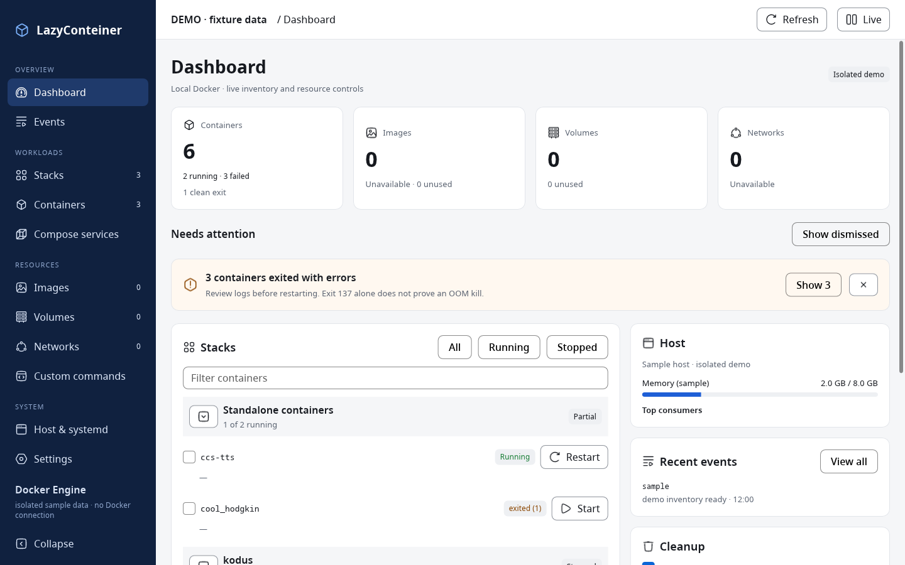

# LazyConteiner

Native Debian Linux Docker GUI built with [Expo Exact](https://github.com/expo/exact) and [Lazydocker](https://github.com/jesseduffield/lazydocker)'s Go core. The dashboard follows [elements-wireframe.md](elements-wireframe.md).



## Run locally

Prerequisites: Go 1.23.6+, Bun 1.4.2+, Rust through rustup, Git, Python 3, and an X11 or Wayland desktop. Docker is needed for live mode; Compose and a terminal emulator are needed for their respective operations.

```sh
make setup             # prepare pinned Exact and native dependencies
make demo              # isolated sample data; no Docker access
make run               # real local Docker inventory and actions
```

The launcher builds both components, creates private session credentials, and cleans up when the window closes or Ctrl+C is pressed. The first build downloads dependencies; subsequent builds reuse caches. The default address is `127.0.0.1:17878`.

X11 runs directly through Exact's winit host. The tracked [Linux patch](patches/README.md) fixes the nested-compositor pointer offset observed on this Debian desktop. Native Wayland remains available. Exact is pinned to `d7b6871218430ed57c5a0fbf34860b28f523d5df`; an existing checkout can be supplied with `EXACT=/path/to/exact`.

## Features

- Dashboard search, filters, alerts, live/pause controls, host metrics and bulk selection.
- Containers, Compose projects/services, images, volumes, networks, custom commands and host details.
- Lifecycle, recreation/build, removal/prune variants, logs, process lists, inspection, environment, image history, events and configurable statistics graphs.
- Exec, attach, following logs and attached Compose startup through a real native terminal.
- Exact-target previews and confirmation before execution, asynchronous job progress and explicit failures.
- Settings editor for project paths, custom argv commands, operation overrides, terminal, logs and statistics.

See the [validation checklist](docs/FEATURES.md) and [57-action / 21-tab inventory](docs/FEATURES-backend.md) for source links, tests and pending human checks. JSON settings provide functional equivalents; existing Lazydocker YAML is not imported. TUI themes/keybindings are not reproduced.

## Validation

```sh
make check             # Exact Contract validation
make test              # Go, Bun adapters and authenticated native UI tests
make test-input        # physical X11 clicks, typing, scrolling, move and resize
make test-live         # disposable Docker/Compose integration checks
make benchmark         # read-only dashboard latency measurements
cd backend && go test -race ./...
```

Live checks require the existing `alpine:3.20` image. They create and remove uniquely labeled test resources, never prune unrelated workloads. Physical input checks require X11, libXtst and ImageMagick. Automated evidence does not substitute for [human validation](docs/FEATURES.md). Performance measurements and limitations are in [PERFORMANCE.md](docs/PERFORMANCE.md).

`fleet/app.contract` and `fleet/workbench.contract` own native layout. Their TypeScript adapters project API replies into Exact's closed shapes. `backend/` owns Docker access and execution. `scripts/dev.py` launches both components. Runtime downloads, session tokens and build outputs remain outside Git.

## Local access and execution

Sensitive inventory, details, settings, previews and jobs require a private session token. The bridge rejects browser origins and unexpected Host headers. Preview tokens expire, are single-use, freeze resolved commands and exact targets, and reject changed identities/configuration. Prune removes only previewed eligible IDs. Sensitive fields remain masked until Reveal.

Docker socket access is root-equivalent. Run as your normal desktop user, not with sudo. Rootless Docker is supported with `DOCKER_HOST=unix:///path/to/docker.sock`; remote TCP/HTTP/SSH endpoints are rejected. Custom commands run with your user's privileges and are not sandboxed. Terminal operations require a configured terminal executable. A successful launch still needs interactive verification in that terminal.

## References

Frontend icons come from [Pagedone](https://pagedone.io/icons). The selected SVGs load locally; [icon mapping and license](docs/ICONS.md) are included.

`BetaB.dc.html`, `support.js` and `vendor/react*.js` belong to the original artboard, not the native runtime. Lazydocker's MIT notice is preserved in `backend/LICENSE.lazydocker`. [WORKFLOW.md](WORKFLOW.md) records standing development skill preferences.
