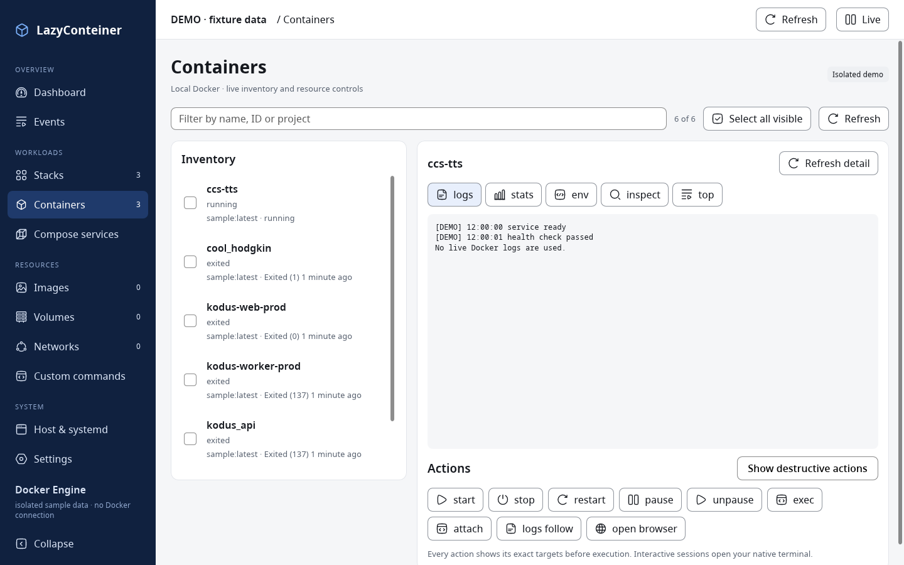
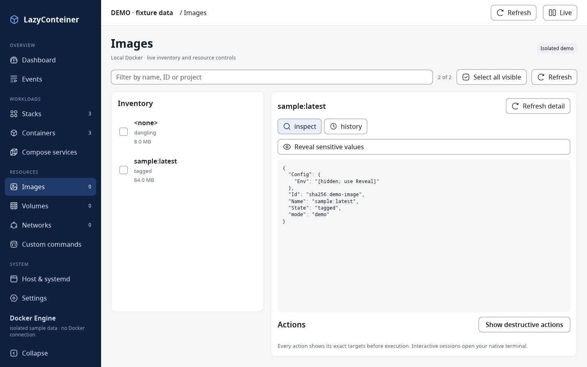
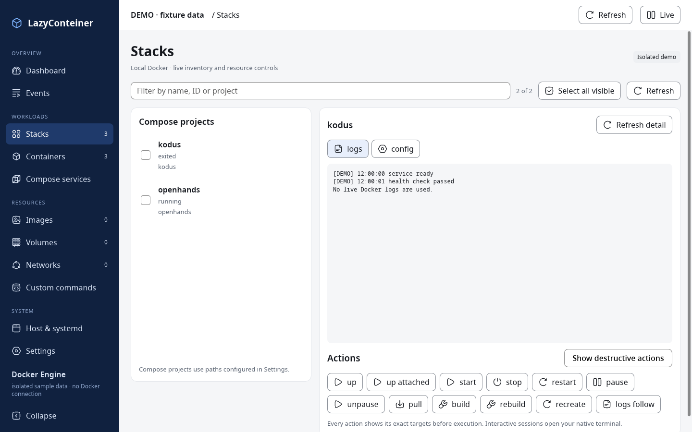
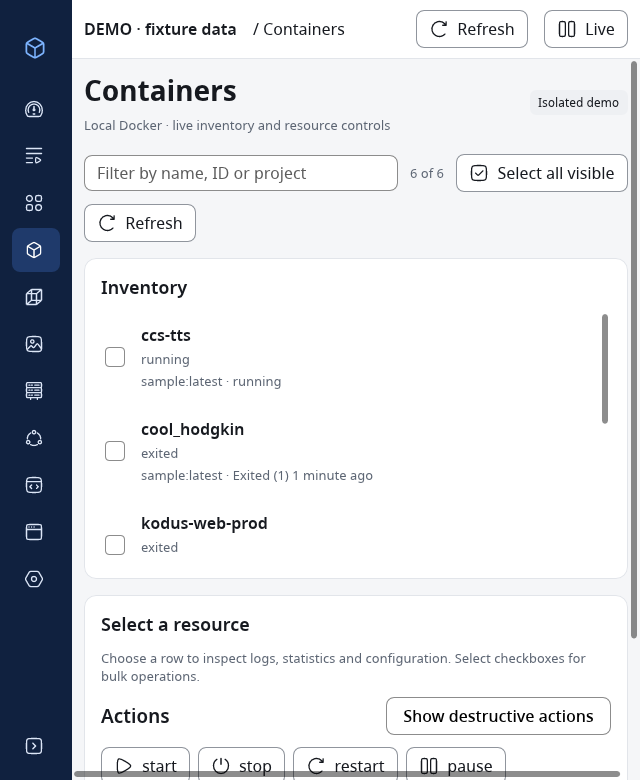

<p align="center">
  
</p>

# LazyConteiner

**A GUI for containers—for those days when you’re not feeling nerdy enough for the terminal.**

LazyConteiner is a native desktop app for managing **local Docker containers on Debian Linux**. See what is running, inspect logs and resources, manage Compose projects, and review actions before executing them—all from one interface.

Built with [Expo Exact](https://github.com/expo/exact) and [Lazydocker's Go core](https://github.com/jesseduffield/lazydocker). It runs as your desktop user and works with your existing Docker installation.

**[Download v1.0.0](https://github.com/AxiomaAbsurdo/LazyConteiner/releases/tag/v1.0.0)** · [Install](#install) · [Screenshots](#screenshots) · [Contribute](CONTRIBUTING.md) · [Product and video kit](docs/media/README.md)


## What it does

- **Understand your local environment.** Dashboard, inventory, search, filters, status and resource details.
- **Manage Docker resources.** Containers, Compose projects and services, images, volumes and networks.
- **Investigate problems.** Logs, statistics, process lists, inspection, image history and Docker events.
- **Act deliberately.** Select resources, review exact targets, confirm an operation and follow its result. Destructive operations require confirmation.
- **Keep your terminal available.** Exec, attach and following logs open an external native terminal for interactive work.
- **Adapt your workflow.** Configure Compose paths, terminal commands, custom commands, log options and statistics.
- **Explore safely.** Demo mode uses sample data without accessing Docker.

The implementation exposes **57 action IDs and 21 detail tabs**. [Feature coverage](docs/FEATURES.md) distinguishes automated tests from pending human checks; an available action is not a guarantee that every external tool or Compose recipe works on every machine.

## What it is—and what it is not

LazyConteiner is a desktop interface for **one local Docker environment**, with a small authenticated bridge running alongside the window.

It is **not** a Docker engine or installer, a container runtime, a Kubernetes dashboard, a hosted control panel, or a remote fleet manager. It does not replace Docker or Compose. Podman is not a supported backend in v1.0.0. Remote TCP/HTTP/SSH Docker endpoints are rejected; local Unix sockets, including rootless Docker sockets, are supported.

It uses Lazydocker's core, but does not embed the terminal UI or import Lazydocker YAML, themes or keybindings. Interactive sessions use your configured external terminal rather than an embedded terminal pane. The main application is a native Exact window, not a browser dashboard.

## Install

### Requirements

- **Debian 13 (trixie), amd64/x86-64**, with a desktop session.
- Your existing local Docker daemon and permission to access its Unix socket for live mode.
- Docker CLI, Compose and a terminal emulator for operations that need those tools.

The `.deb` supplies the compiled GUI, backend, icons and desktop entry. APT resolves its runtime dependencies. **No Go, Rust, Bun or source checkout is needed to use the app.** Debian 12, ARM64, Windows and macOS are not supported by this release artifact. X11 is the primary validated desktop path; the runtime also supports Wayland, with broader desktop testing still welcome.

### Download and install v1.0.0

Download both assets from the [release page](https://github.com/AxiomaAbsurdo/LazyConteiner/releases/tag/v1.0.0):

- `lazyconteiner_1.0.0-1_amd64.deb`
- `lazyconteiner_1.0.0-1_amd64.deb.sha256`

Open a terminal in the download directory:

```sh
sha256sum -c lazyconteiner_1.0.0-1_amd64.deb.sha256
sudo apt install ./lazyconteiner_1.0.0-1_amd64.deb
lazyconteiner --version
```

The checksum detects corruption; it is not a substitute for trusting the release source.

### First launch

Open **LazyConteiner** from your application menu, or run:

```sh
lazyconteiner --demo   # sample data; no Docker access
lazyconteiner          # your local Docker environment
```

Close the demo before launching live mode. Only one instance uses port `127.0.0.1:17878` at a time. **Run the app without sudo.** Installation does not install a Docker daemon, change group membership or create a system service. Closing the window stops the app's bridge, not your containers.

For rootless Docker, use the socket path supplied by your Docker setup:

```sh
DOCKER_HOST="unix:///run/user/$(id -u)/docker.sock" lazyconteiner
```

### Upgrade or uninstall

Install a newer `.deb` with the same `sudo apt install ./<filename>.deb` command. It upgrades the existing package, including release candidates; no uninstall is needed first. GitHub downloads do not provide automatic updates or configure an APT repository.

```sh
sudo apt remove lazyconteiner
```

Removal preserves Docker resources and your user configuration/logs.

### Troubleshooting

- **Docker unavailable:** verify `docker info` works as your normal user. Check the selected Unix socket and your Docker permissions.
- **Port already in use:** close another LazyConteiner window or source-development run. The launcher refuses to take over an existing listener.
- **Terminal or Compose operation fails:** verify the relevant executable and configure the terminal/project path under Settings.
- **Startup fails:** run `lazyconteiner --smoke-test` and inspect `~/.local/state/lazyconteiner/backend.log` and `ui.log`. The smoke check verifies executables and the authenticated demo bridge; it does not test GUI rendering.
- **Settings location:** `~/.config/lazyconteiner/config.json`. Standard XDG overrides are supported.

See [packaging details](docs/PACKAGING.md) for build instructions, file locations and platform limitations. When reporting a bug, remove credentials and private workload information from logs.

## Screenshots

These are real native-app captures using **isolated demo data**, not production workloads or rendered mockups.

| Containers and actions | Images and details |
| --- | --- |
|  |  |

| Compose projects | Narrow desktop window |
| --- | --- |
|  |  |

The [media kit](docs/media/README.md) contains full-resolution screenshots, icon sources, a complete product description, a shot list and a ready-to-use video-agent brief.

## Performance and safety

Filtering and selection reuse local inventory state. Expensive details load on demand; caching and bounded output limit repeated work. [Measured results and limitations](docs/PERFORMANCE.md) report cold and warm behavior separately. They are measurements from one workstation, not universal speed or memory guarantees.

The bridge listens on loopback, requires private session credentials for sensitive operations, rejects browser origins, and uses one-use previews with frozen targets before mutations. Sensitive fields remain masked until Reveal.

**Docker socket access is root-equivalent.** Review targets before destructive actions. Custom commands execute with your user's privileges and are not sandboxed. Use disposable resources when exploring removal or prune operations.

## Contribute

Bug reports, Debian testing, accessibility feedback, documentation and focused pull requests are welcome. Read [CONTRIBUTING.md](CONTRIBUTING.md) for setup, test selection and a useful bug-report template.

For development, install Go 1.23.6+, Bun 1.4.2+, Rust through rustup, Git and Python 3, then:

```sh
git clone https://github.com/AxiomaAbsurdo/LazyConteiner.git
cd LazyConteiner
make setup
make demo
```

`make setup` downloads the pinned Exact runtime and build dependencies. See the contribution guide for Debian build packages. `make run` connects to your existing local Docker environment.

## Support the project

If LazyConteiner saves you time, consider supporting its maintenance. You can also help by starring the repository, reporting reproducible bugs and testing Debian releases.

**[Buy me a coffee via PayPal](https://paypal.me/mmortara01)** — one-time donations help support development and testing. Contributions are optional; the application remains MIT licensed.

## License and credits

LazyConteiner's own code is [MIT licensed](LICENSE). Third-party components retain their licenses.

- [Expo Exact](https://github.com/expo/exact): native application runtime.
- [Lazydocker](https://github.com/jesseduffield/lazydocker): Docker core and workflow inspiration; [MIT notice](backend/LICENSE.lazydocker).
- [Pagedone](https://pagedone.io/icons): bundled interface icons under their [separate terms](docs/ICONS.md).
- Application icon: supplied for this project; desktop variants ship in the Debian package.

The original artboard and its web dependencies are design references, not the native application runtime. The installer includes dependency notices under `/usr/share/doc/lazyconteiner/`.
